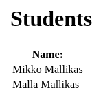

# studentList

Spring Boot exercise: a controller at `/hello` builds a list of 2 students (Mikko and Malla Mallikas) and hands it to a Thymeleaf template, `studentList.html`, that prints their names in a table.



The student list at `/hello`. Screenshot from a local run of the fixed code, 25 October 2026.

Stack: Java 17, Spring Boot 3.1.3, Thymeleaf, Maven wrapper. The code is in `demo/`.

Run:

```
cd demo
./mvnw spring-boot:run       # macOS / Linux
mvnw.cmd spring-boot:run     # Windows
```

Then open http://localhost:8080/hello

Test: `./mvnw verify` in `demo/` runs a MockMvc test that both names render.

Fixed in the October 2026 review (it didn't work as committed):
- `DemoController` was in `com.example.java.web`, outside the `com.example.demo` scan root, so `/hello` wasn't mapped. It's in `com.example.demo.web` now.
- `pom.xml` had no Thymeleaf starter, so the template couldn't render.
- The template read `student.firsName`, a typo for `firstName`.
- `mvnw` wasn't executable.

Not finished: the students are hard-coded in the controller, there's no database. Spring Boot 3.1.x has been out of open source support since May 2024.

Status: course assignment, 1 commit on 6 September 2023.
